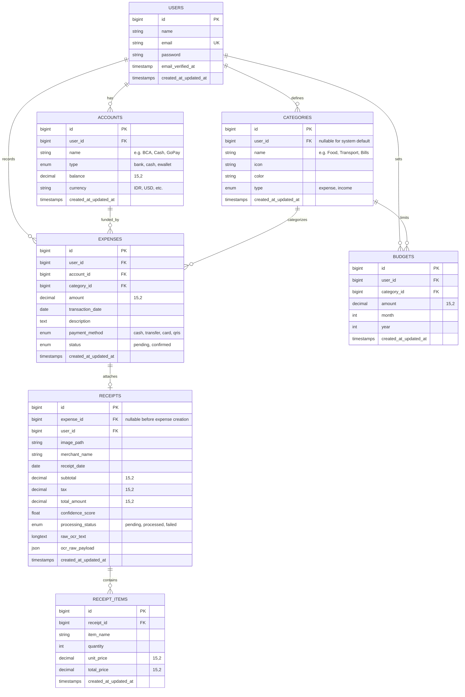
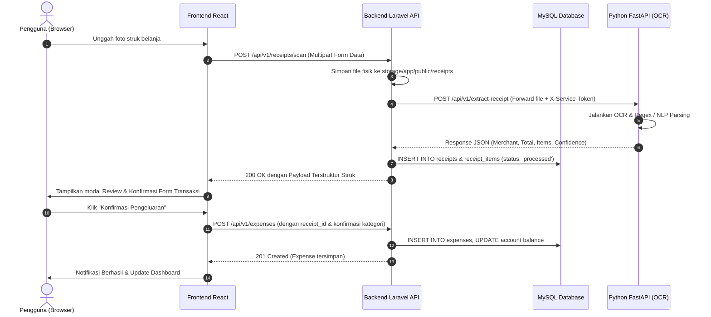

# ARCHITECTURE & SYSTEM DESIGN
**Project:** Smart Expense & Receipt Tracker  
**Architecture:** Monorepo (`/backend-laravel`, `/service-python`, `/frontend-react`)

---

## 1. Monorepo Structure Overview

```text
smart-expense-tracker/
│
├── backend-laravel/          # Core Business Logic, Authentication, DB Migrations & REST API
│   ├── app/
│   ├── routes/api.php
│   ├── database/migrations/
│   └── ...
│
├── service-python/           # Microservice for OCR & Receipt AI Parsing (FastAPI)
│   ├── app/
│   │   ├── api/
│   │   ├── services/         # OCR & Parser engines
│   │   └── schemas/
│   ├── main.py
│   └── requirements.txt
│
├── frontend-react/           # Single Page Application (Vite + React + Tailwind CSS)
│   ├── src/
│   │   ├── components/
│   │   ├── pages/
│   │   └── services/
│   └── package.json
│
└── ARCHITECTURE.md           # System Blueprint & Contracts
```

---

## 2. Tech Stack

- **Backend:** Laravel 11.x (API Mode, Laravel Sanctum, MySQL, GuzzleHttp client)
- **AI/OCR Service:** Python 3.10+ / FastAPI, Uvicorn, Pydantic v2, OCR Engine (Tesseract/PaddleOCR/PyMuPDF)
- **Frontend:** React 18+ (Vite), Tailwind CSS, Axios, Lucide Icons
- **Database:** MySQL 8.0+

---

## 3. Database Schema & MySQL ERD

### Mermaid ERD



### Table Definitions Summary

| Table | Purpose |
|---|---|
| `users` | Akun pengguna sistem |
| `accounts` | Sumber dana / dompet (Rekening Bank, Tunai, E-Wallet) |
| `categories` | Kategori pemasukan dan pengeluaran |
| `expenses` | Catatan transaksi keuangan |
| `receipts` | Metadata & hasil ekstraksi OCR dari struk fisik |
| `receipt_items` | Rincian baris barang dari struk belanja |
| `budgets` | Batas anggaran bulanan per kategori |

---

## 4. API Contract: Laravel ⟷ Python (FastAPI) Service

Laravel bertindak sebagai API Gateway & Orchestrator. Saat pengguna mengunggah gambar struk, Laravel meneruskan file atau path gambar ke Python FastAPI service untuk diekstrak.

### Base Configuration
- **Base URL:** `http://127.0.0.1:8001` (Default local development)
- **Security:** Shared API Key via header `X-Service-Token: ${PYTHON_SERVICE_SECRET}`
- **Timeout:** Connection timeout 5s, Read timeout 30s

---

### Endpoint 1: Health & Readiness Check

- **Method:** `GET`
- **Path:** `/api/v1/health`
- **Request Headers:**
  ```http
  Accept: application/json
  ```
- **Response `200 OK`:**
  ```json
  {
    "status": "healthy",
    "version": "1.0.0",
    "ocr_engine": "available"
  }
  ```

---

### Endpoint 2: Extract Receipt Data (Multipart Upload)

Menerima file gambar struk (JPEG, PNG, WEBP, PDF) dan mengembalikan hasil OCR terstruktur.

- **Method:** `POST`
- **Path:** `/api/v1/extract-receipt`
- **Request Headers:**
  ```http
  X-Service-Token: <SECRET_TOKEN>
  Content-Type: multipart/form-data
  ```
- **Form Data:**
  - `file`: `Binary` (Image file, max 10MB)
  - `currency_hint`: `string` (Optional, default: `"IDR"`)

#### Response Success `200 OK`
```json
{
  "success": true,
  "confidence_score": 0.94,
  "data": {
    "merchant": {
      "name": "INDOMARET POINT",
      "address": "Jl. Sudirman No. 45, Jakarta",
      "phone": "021-5551234"
    },
    "transaction": {
      "date": "2026-11-15",
      "time": "14:23:00",
      "invoice_number": "TRX-9821841"
    },
    "financials": {
      "subtotal": 45000.00,
      "tax": 4950.00,
      "discount": 0.00,
      "total_amount": 49950.00,
      "currency": "IDR"
    },
    "items": [
      {
        "name": "ROTI TAWAR SARI ROTI",
        "qty": 1,
        "unit_price": 16500.00,
        "total_price": 16500.00
      },
      {
        "name": "ULTRA MILK PLAIN 1L",
        "qty": 1,
        "unit_price": 21000.00,
        "total_price": 21000.00
      },
      {
        "name": "AQUA 600ML",
        "qty": 2,
        "unit_price": 3725.00,
        "total_price": 7450.00
      }
    ],
    "suggested_category": "Food & Groceries"
  },
  "raw_text": "INDOMARET POINT\nJL SUDIRMAN NO 45\n..."
}
```

#### Response Validation Error `422 Unprocessable Entity`
```json
{
  "success": false,
  "error_code": "UNSUPPORTED_MEDIA_TYPE",
  "message": "File format must be JPEG, PNG, WEBP, or PDF."
}
```

#### Response Processing Error `500 Internal Server Error`
```json
{
  "success": false,
  "error_code": "OCR_EXTRACTION_FAILED",
  "message": "Failed to parse receipt text clearly. Please retake photo with better lighting."
}
```

---

## 5. End-to-End Sequence Diagram


